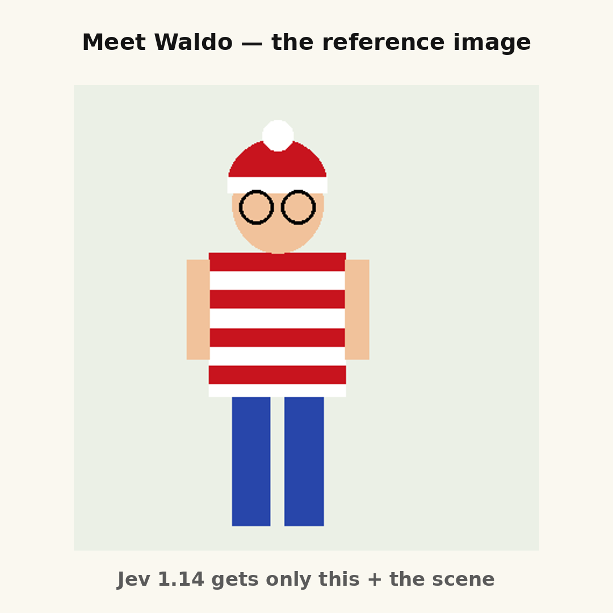
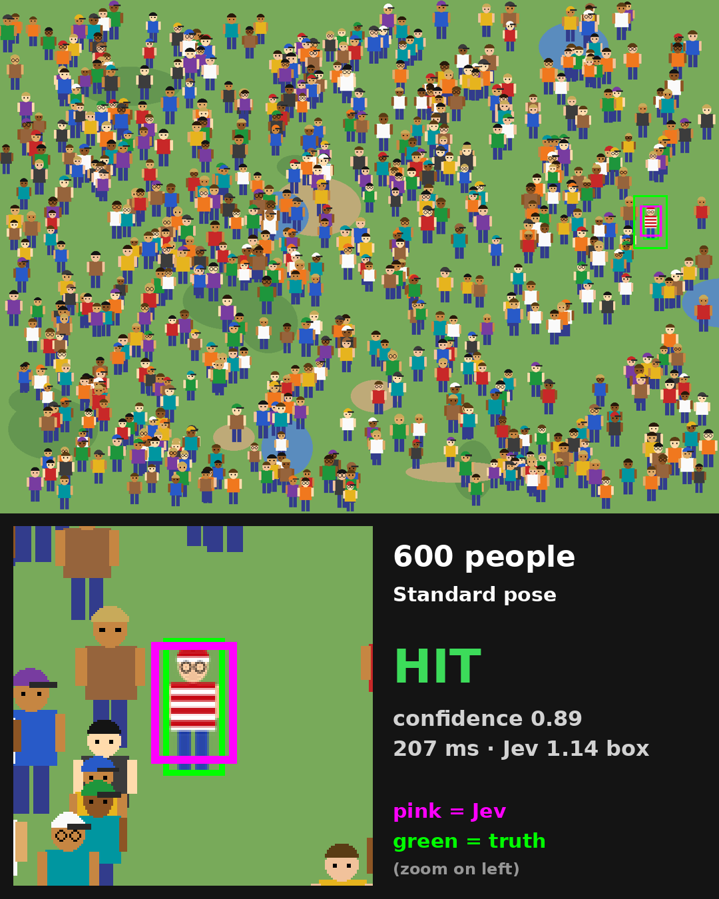
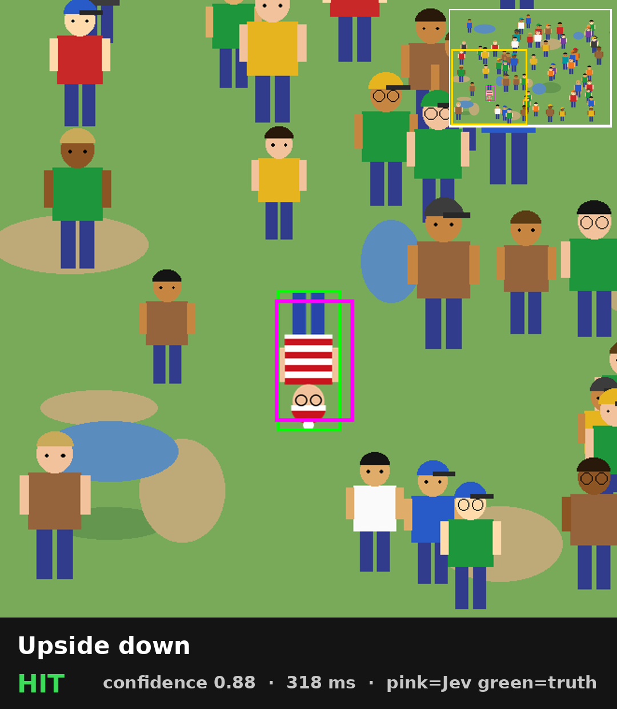
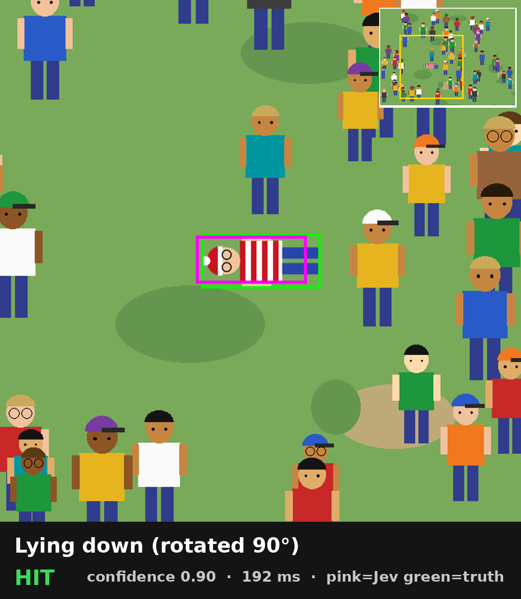
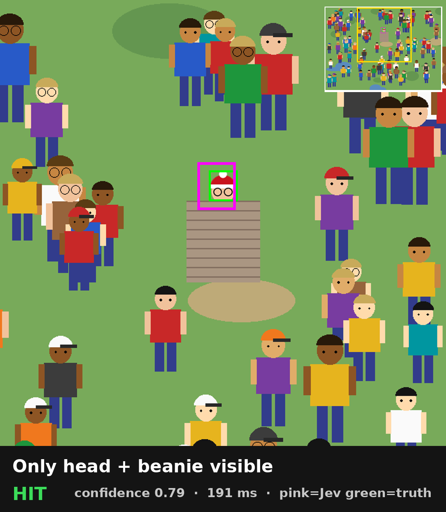

# Where's Waldo? 🔴⚪ — Jev 1.14 `box` vs. a crowd

Can a vision model find one specific character in a crowd when it only gets **one reference image** — and the character never looks like the reference?

This repo generates "Where's Waldo"-style scenes with exact ground truth and asks **Jev 1.14** (TypeSafe, `jev-preview`) a single typed `box` question: *"mark Waldo"*. Jev returns a bounding box plus a confidence score.

<p align="center">
  
  &nbsp;&nbsp;
  
  <br/><em>Left: the only reference Jev gets. Right: a 600-person scene — magenta = Jev's box, green = ground truth.</em>
</p>

## How it works

1. **Generate** (`generate.py`, no API needed): procedurally draw a crowd of cartoon people on a 1400x1000 canvas and hide Waldo (striped shirt, striped beanie with pompom, round glasses, blue trousers) somewhere in it — but **not** as in the reference: lying down, upside down, tilted, mirrored, sitting on a bench, back turned, shrunk or enlarged, behind a bush / wall / tree / another person, cut by the frame edge, or only his head peeking out. Some scenes add striped look-alike **decoys** (wrong glasses, vertical stripes, red-black stripes, pink stripes...). Ground truth is the bounding box of Waldo's *visible* pixels (plus his full-body box for occluded scenes).
2. **Ask** (`evaluate.py`): one request containing two images in the state — `reference_character` and `scene` — and one `box` question:
   > the person in `scene` who is the same character as `reference_character` (...). The character may be in a different pose, rotated, seen from behind, or partially hidden

   Jev answers `{"box": {"top","left","bottom","right"}, "confidence"}` (normalized coordinates).
   Optional **tiled** mode splits the scene into a 2x2 (or 3x3) grid with 15% overlap and asks a `noul` ("is he visible here?") + `box` question per tile in the same request, then picks the tile with the highest `p_visible x confidence`.
3. **Score**: a hit = the center of Jev's box falls inside Waldo's visible box (±3 px), or, for occluded scenes, inside his full-body box. Annotated images are saved (green = truth, magenta = Jev).

## Results (measured, files in [`results/`](results))

**Round 1 — 72 scenes, 30-120 people, poses + occlusion + decoys** (single call)

| subset | hits |
|---|---|
| different pose, fully visible | 42 / 42 |
| partially hidden (incl. only the head above a bush) | 21 / 21 |
| with 8 striped decoys | 3 / 5 |
| **total** | **70 / 72 (97%)** |

**Round 2 — 54 genuinely hard scenes: 200-600 people, Waldo at 0.3-0.6x size, varied poses and occlusion, 1/3 with 15 decoys**

| mode | hits |
|---|---|
| single call | 28 / 54 (52%) |
| 2x2 tiles | 37 / 54 (69%) |
| 3x3 tiles | 22 / 54 (41%) |

Crowd size barely mattered (600 people was no harder than 200). What breaks it: 15 striped decoys, tiny Waldo, and upside-down / lying Waldo.

**It knows when it doesn't know.** Across all 126 single-call scenes:

| confidence | correct |
|---|---|
| ≥ 0.7 | **79 / 79** |
| 0.3 - 0.7 | 12 / 14 |
| < 0.3 | 7 / 33 |

**Speed & cost:** ~0.2 s per scene even with 600 people (median 222 ms in round 2), ~$0.0002 per scene; all 126 scenes cost under 7 cents.

Reproduce these numbers from the saved results: `python summarize.py results/*.json`
(`round1_results.json` also contains an earlier 45-scene tiled run on the harder round-1 subsets.)

<p align="center">
    
  <br/><em>Upside down, lying, only the head peeking out.</em>
</p>

## Run it

```bash
pip install -r requirements.txt

# 1) Generate scenes (deterministic, no API key needed)
python generate.py --round 1 --out data/round1     # 72 scenes
python generate.py --round 2 --out data/round2     # 54 hard scenes

# 2) Ask Jev (needs a TypeSafe API key)
cp .env.example .env   # or just: export TYPESAFE_API_KEY=...
export TYPESAFE_API_KEY=...
python evaluate.py data/round2 --modes single tiled2 --limit 5

# 3) Summarize
python summarize.py data/round2/results/results.json
```

Seeds are fixed, so `generate.py` reproduces the exact scenes and ground truth used in the results above.

## Layout

```
generate.py           scene + ground-truth generator (rounds 1 and 2)
evaluate.py           Jev box / tiled evaluation, scoring, annotated images
summarize.py          accuracy + confidence calibration from results.json
wheres_waldo/draw.py   cartoon people, decoys, Waldo, reference image
wheres_waldo/scenes.py poses, occlusions, scene composition, exact GT
wheres_waldo/jev.py    tiny TypeSafe API client (reads TYPESAFE_API_KEY)
results/              raw results of the published runs
assets/               README images
```

All characters are original procedural drawings (an homage to Waldo, not the copyrighted artwork).

## License

MIT
